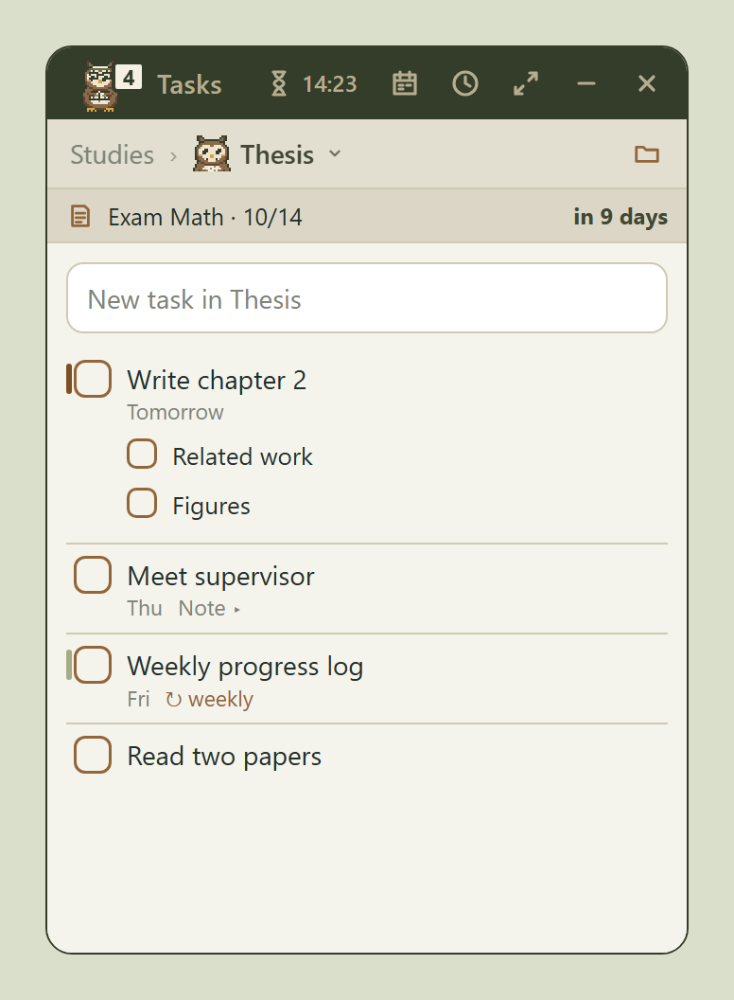
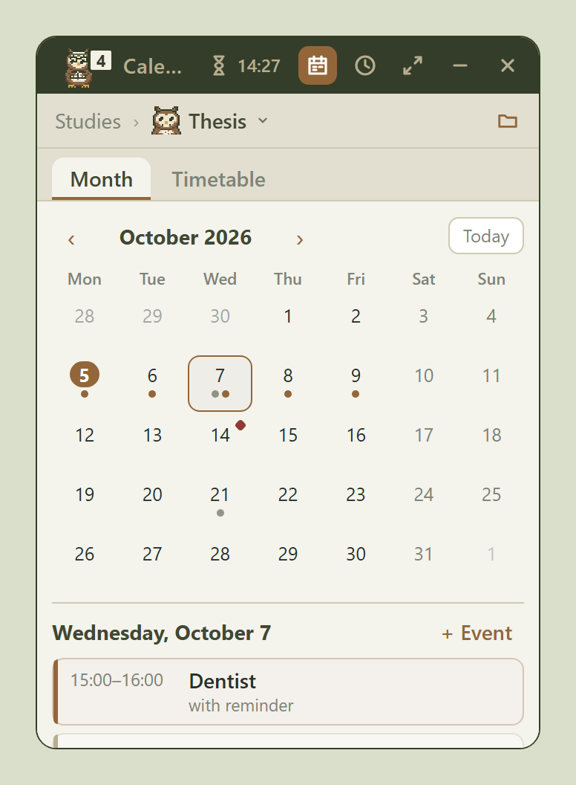
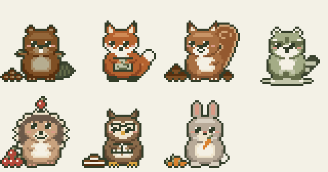

<p align="center"></p>

# Taskwood

A small task planner for Windows with pixel animals as companions.

A beaver, fox, squirrel, raccoon, hedgehog, owl or rabbit sits on your desktop and keeps an eye on
your tasks. Click the animal to open your list. It sleeps when everything is done, works hard when
a lot is due, and jumps for joy when you tick something off.

<p align="center"></p>

<p align="center">
  
  
</p>

## Features

- **Folders and projects**, each project with its own animal and color
- **Tasks** with subtasks, notes, priorities and drag-and-drop sorting
- **Dates right in the text:** “tomorrow”, “Friday”, “in 3 days”, “by Oct 12” (also German)
- **Recurring tasks:** “every Monday”, “daily”, “monthly”
- **Timer per project** with a notification, keeps running when collapsed
- **Calendar** with events, reminders and an exam countdown
- **Class timetable** with day and week view
- **Seven animals** with moods, little jobs and a stash that grows with every completed task
- **Calm mode** if motion distracts you
- **English and German**, backup to a JSON file

All data stays on your device. Taskwood itself makes no network requests: no account, no ads,
no tracking.

<p align="center"></p>

## Installation

Download the installer from **[itch.io](https://taskwood.itch.io)** (Windows 10/11, 64-bit).

Windows SmartScreen may warn about the unsigned installer: click **More info → Run anyway**.

## Building from source

Requirements: [Node.js](https://nodejs.org/) 20+, [Rust](https://www.rust-lang.org/tools/install)
(stable, MSVC toolchain) and the [Tauri prerequisites for Windows](https://tauri.app/start/prerequisites/).

```sh
npm install
npm run tauri dev      # run in development mode
npm run tauri build    # build the NSIS installer (src-tauri/target/release/bundle/nsis)
```

Useful extras:

- `Ctrl+Shift+D` opens a hidden test view for the animals (every mood, event and clip).
- `python scripts/third-party-licenses.py` regenerates `THIRD_PARTY_LICENSES.txt` from the
  dependencies that are actually shipped.

### Project layout

| Path | Contents |
| --- | --- |
| `src/App.tsx` | Main window: folders, projects, tasks, timer, history |
| `src/pet/` | Pixel animal engine: parts, faces, clips and one file per animal |
| `src/Calendar.tsx`, `src/Timetable.tsx` | Calendar and class timetable |
| `src/i18n.ts`, `src/dates.ts` | Translations and date recognition (English/German) |
| `src/data.ts`, `src/backup.ts` | Data model, migration, export/import |
| `src-tauri/` | Tauri (Rust) shell, window and installer configuration |

## License

[MIT](LICENSE) © 2026 Drahtgeber.
Third-party licenses: [THIRD_PARTY_LICENSES.txt](THIRD_PARTY_LICENSES.txt).

Contact: Drahtgeber@gmail.com
